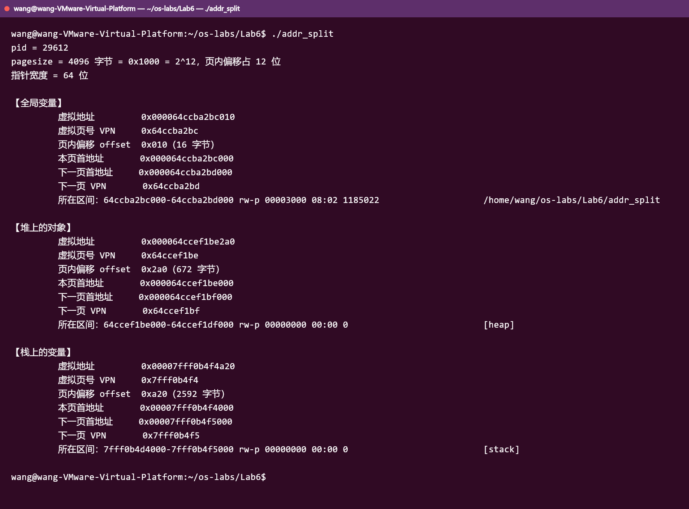
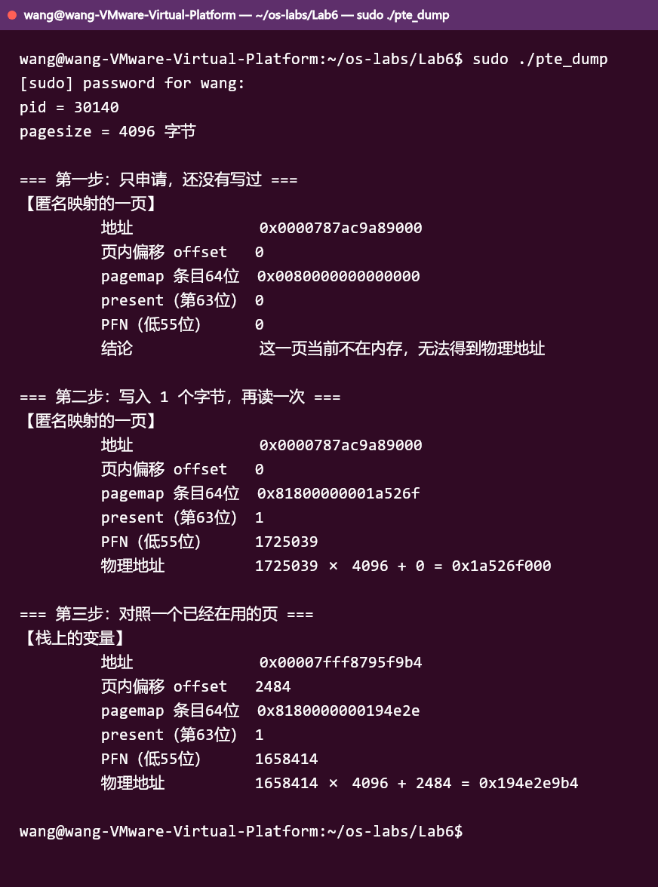
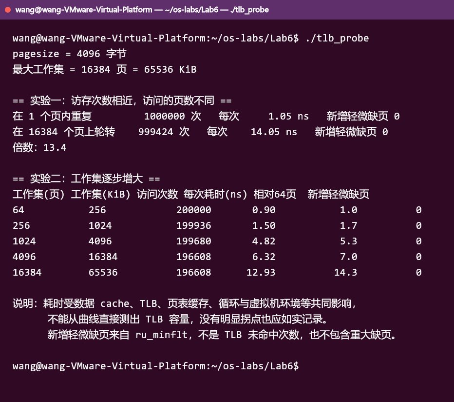

# Lab6：虚拟地址分解、页表状态与 TLB 观测

> **实验目标**：识别虚拟地址、虚拟页号与页内偏移；观测一个匿名页在首次写入前后的驻留状态（present/PFN）；观察工作集增大时跨页访问的耗时趋势，并理解分页机制的作用与代价。
>
> **实验范围**：必做内容为 3.1 准备、3.2 地址拆分、3.3 页表状态、3.4 耗时与缺页、四 结果分析与机制验证，以及六 列出的 3 张截图。"重复运行"为选做；"故障排查""自查表"为辅助内容。
>
> **执行环境**：使用 Lab1 至 Lab4 的 Ubuntu 虚拟机（Ubuntu 24.04.4 LTS）。三个程序 `addr_split.c`、`pte_dump.c`、`tlb_probe.c` 由课程提供，全部编译与运行均在 Ubuntu 中完成。
>
> **提交材料**：填写完成的 `Lab6.md` 与三张截图 `imgs/lab6_split.png`、`imgs/lab6_pagemap.png`、`imgs/lab6_tlb.png`。
>
> **执行要求**：命令逐条执行，每次检查输出后再继续。下文标注"本机"与"Ubuntu"，避免混用。

## 一、实验原理

### 1.1 虚拟页号与页内偏移

虚拟地址空间按固定大小划分为页，各页从 0 开始编号。一个虚拟地址由虚拟页号（VPN）与页内偏移（offset）两部分确定：

```text
VPN    = addr ÷ ps 的整数商
offset = addr 除以 ps 的余数
addr   = VPN × ps + offset
```

例如页大小为 4096 字节、虚拟地址为 4102 时，`4102 = 1 × 4096 + 6`，故 VPN = 1、offset = 6。

### 1.2 页边界与偏移位数

4 KiB = 4096 字节，采用该页大小时前三个虚拟页的地址范围（两端均含）为：

| VPN | 虚拟地址范围（十进制） |
| :---: | :--- |
| 0 | 0～4095 |
| 1 | 4096～8191 |
| 2 | 8192～12287 |

余数小于除数，因此 `0 ≤ offset < ps`。4 KiB 页的偏移范围是 0～4095；由于 `4096 = 2¹²`，偏移占 12 个二进制位，对应 3 位十六进制。

```text
本页首地址   = addr − offset
下一页首地址 = 本页首地址 + ps
```

### 1.3 页表、驻留状态与 TLB

地址分解只得到 VPN 与偏移，尚未确定物理地址。页表记录虚拟页与物理页框的对应关系；页表项中的 present 位表示页是否在内存（驻留）。在目标页已驻留且权限允许时，由 PFN 构造物理地址：

```text
物理地址 = PFN × 页大小 + 页内偏移
```

`/proc/self/pagemap` 是内核导出格式，不是原始硬件页表项：每项 8 字节，第 63 位为 present，第 62 位为 swapped，低 55 位在页驻留时表示 PFN。PFN 的可见性依赖 CAP_SYS_ADMIN 等权限，普通用户读到 0 不一定表示页不在内存。

TLB 缓存地址转换结果。工作集增大时，TLB 与数据 cache、页表缓存、循环和虚拟机调度等因素共同影响访问耗时，不能从曲线直接测出 TLB 容量。`ru_minflt` 统计的是轻微缺页，不是 TLB 未命中，也不包含重大缺页。

### 1.4 页与内存映射区间

`/proc/PID/maps` 中一条映射记录可覆盖多个连续虚拟页，因此"映射区间起点"与"对象所在页首地址"不一定相同：

```text
映射区间起点 ≤ 对象虚拟地址 < 映射区间终点
```

## 二、3.1 准备

| 项目 | 本人实测结果 |
| :--- | :--- |
| 练习目录完整路径（`pwd` 输出） | `/home/wang/os-labs/Lab6` |
| Ubuntu 用户名（`whoami`） | `wang` |
| 虚拟机 IP（`hostname -I`） | `192.168.170.128` |
| 源码传送方式 | scp（本机终端执行 `scp ... wang@192.168.170.128:~/os-labs/Lab6/`） |
| gcc 版本（`gcc --version` 第一行） | `gcc (Ubuntu 13.3.0-6ubuntu2~24.04.1) 13.3.0` |
| `addr_split.c` 编译（`gcc -O0 -o addr_split addr_split.c`）结束状态 `echo $?` | 0 |
| `pte_dump.c` 编译（`gcc -O0 -o pte_dump pte_dump.c`）结束状态 `echo $?` | 0 |
| `tlb_probe.c` 编译（`gcc -O2 -o tlb_probe tlb_probe.c`）结束状态 `echo $?` | 0 |
| 三个可执行文件是否齐全 | 齐全：`addr_split`(16688 B)、`pte_dump`(16592 B)、`tlb_probe`(16488 B)，权限均含 `x`，编译过程无报错 |

本机课程仓库的 `homework/Lab6/` 目录中没有题目文件，实验所需的三个源码由课程另行提供；虚拟机中未克隆仓库，源码直接传送到练习目录。

## 三、运行前预测

**3.2 的两个问题**

1. *全局变量、堆对象、栈变量三个地址的页内偏移是否都落在 0～4095 之内？全局变量的下一页 VPN 是否等于当前 VPN 加 1？*
   预测：是。offset 是除以页大小的余数，必小于 4096；下一页首地址是当前页首地址加一个页大小，页号恰好加 1。理由：这是整除与取余的定义所保证的。
2. *全局变量、堆对象、栈变量是否位于同一虚拟页、同一映射区间？*
   预测：不在同一页、也不在同一区间。理由：数据段、堆、栈由链接器和内核分别安排在不同区域，地址相差很远。

**3.3 的两阶段 present**

1. *匿名页只申请、尚未写入时 present 是多少？* 预测：0。理由：匿名页按需分配，未写入时内核尚未为其分配物理页。
2. *写入 1 个字节之后 present 是多少？* 预测：1。理由：首次写入触发轻微缺页，内核分配物理页并建立可写映射，页变为驻留。

**3.4 的两个问题**

1. *访存次数相近时，在 1 个页内重复访问与在 16384 个页上轮转，哪个每次耗时更长？*
   预测：多页轮转明显更长，倍数在数倍到十几倍。理由：跨页访问需要更多的地址转换，TLB/cache 局部性更差。
2. *工作集从 64 页增大到 16384 页，每次访问耗时如何变化？*
   预测：随工作集增大而上升。理由：工作集超过转换与缓存结构的覆盖范围后，命中率下降。

## 四、3.2 地址拆分

### 4.1 环境参数

| 参数 | 本次实测值 |
| :--- | :--- |
| 页大小 `pagesize` | 4096 字节 = 0x1000 = 2^12 |
| 页内偏移位数 | 12 |
| 指针宽度 | 64 位 |
| 本课模型假设的虚拟地址位数 | 48 位 |
| 模型 VPN 位数（48 − 偏移位数） | 48 − 12 = 36 位 |

说明：48 位是本课模型假设；模型 VPN 位数由"48 减本次偏移位数"得到，不能根据 maps 地址打印长度推断硬件支持位数。

### 4.2 三个对象的地址分解（本人实测，同一次运行 `./addr_split`，pid = 29612）

VPN 与 offset 按下式核对：`VPN = addr ÷ 4096` 的整数商，`offset = addr mod 4096`。

| 对象 | 完整虚拟地址 | 页号 VPN（十进制） | 页内偏移 offset（十进制） |
| :--- | :--- | :--- | :--- |
| 全局变量 | `0x000064ccba2bc010` | 27058217660 | 16 |
| 堆上的对象 | `0x000064ccef1be2a0` | 27058434494 | 672 |
| 栈上的变量 | `0x00007fff0b4f4a20` | 34358736116 | 2592 |

**逐项核对**

- 全局变量：`27058217660 × 4096 + 16 = 0x000064ccba2bc010`，即 `0x64ccba2bc × 0x1000 + 0x010`。
- 堆上的对象：`27058434494 × 4096 + 672 = 0x000064ccef1be2a0`，即 `0x64ccef1be × 0x1000 + 0x2a0`。
- 栈上的变量：`34358736116 × 4096 + 2592 = 0x00007fff0b4f4a20`，即 `0x7fff0b4f4 × 0x1000 + 0xa20`。
- 三个 offset 分别为 16、672、2592，均满足 `0 ≤ offset < 4096`。
- 全局变量的下一页首地址对应 VPN 为 27058217661（0x64ccba2bd），当前 VPN 为 27058217660，两者相差 1，符合"下一页 VPN = 当前 VPN + 1"。

### 4.3 所在映射区间与解释

| 对象 | 所在区间（`rw-p`） | 说明 |
| :--- | :--- | :--- |
| 全局变量 | `64ccba2bc000-64ccba2bd000 rw-p 00003000 08:02 1185022 /home/wang/os-labs/Lab6/addr_split` | 落在可执行文件的可写数据映射中，与预期一致 |
| 堆上的对象 | `64ccef1be000-64ccef1df000 rw-p 00000000 00:00 0 [heap]` | malloc 对象位于 `[heap]` |
| 栈上的变量 | `7fff0b4d4000-7fff0b4f5000 rw-p 00000000 00:00 0 [stack]` | 局部变量位于 `[stack]` |

解释：三个对象落在不同的映射区域，预测成立。权限串 `rw-p` 表示可读、可写、不可执行、私有映射。全局变量所在页首地址 `0x000064ccba2bc000` 恰好等于其映射区间起点；栈变量所在页首地址 `0x00007fff0b4f4000` 落在栈区间 `[7fff0b4d4000, 7fff0b4f5000)` 内部，而区间起点更小——这说明一个映射区间可以包含多个页，区间起点不要求等于对象所在页的首地址。

## 五、3.3 页表状态

### 5.1 三阶段输出

普通用户直接运行时 PFN 被内核清零（`./pte_dump`，pid = 30079），用于对比：第一步 present = 0、第二步 present = 1、第三步 present = 1，但三步 PFN 均为 0。用 sudo 运行可看到真实 PFN（`sudo ./pte_dump`，pid = 30140），本次以 sudo 版作为核对依据：

| 阶段 | 对象 | 地址 | offset | present | PFN | 结论 / 物理地址 |
| :--- | :--- | :--- | :--- | :---: | :--- | :--- |
| 第一步：只申请未写入 | 匿名映射的一页 | `0x0000787ac9a89000` | 0 | 0 | 0 | 页当前不在内存，无法得到物理地址 |
| 第二步：写入 1 字节后 | 匿名映射的一页 | `0x0000787ac9a89000` | 0 | 1 | 1725039 | 物理地址 = 1725039 × 4096 + 0 = `0x1a526f000` |
| 第三步：对照在用页 | 栈上的变量 | `0x00007fff8795f9b4` | 2484 | 1 | 1658414 | 物理地址 = 1658414 × 4096 + 2484 = `0x194e2e9b4` |

### 5.2 解释题

**（1）为什么首次写入会使 present 从 0 变为 1？页内容是否需要从磁盘读入？**
只申请匿名映射时，内核仅建立虚拟地址到空表项的映射，尚未分配物理页，故 present = 0。首次写入触发一次**轻微缺页（minor fault）**：内核分配一个物理页框并清零，在页表中建立可写映射，然后重新执行（指令重试）那条写入指令，此后 present = 1。本次是匿名页的首次写入，页内容全部为零，不需要从磁盘读取页内容，因此是轻微缺页而非重大缺页。

**（2）物理地址公式，并代入本次数据。**
物理地址 = PFN × 本次页大小 + 页内偏移。本次页大小为 4096：第二步 = 1725039 × 4096 + 0 = 0x1a526f000；第三步 = 1658414 × 4096 + 2484 = 0x194e2e9b4。转换前后页内偏移保持不变。

**（3）为什么普通用户下 PFN 为 0？去掉 sudo 的结果如何解释？**
普通用户运行时三步 PFN 都是 0，但第二步、第三步 present 均为 1，说明页确实在内存；PFN 为 0 是内核出于减少物理地址布局信息泄露的考虑，对不具备 CAP_SYS_ADMIN 等权限的进程隐藏了 PFN，并不表示页未驻留。sudo 版能看到非零 PFN，验证了这一点。因此不能用普通用户的 PFN = 0 判定页不在内存，也不据此计算物理地址；两次运行地址不同，不能把普通版的地址与 sudo 版的 PFN 拼接计算。

**（4）pagemap 是否等于硬件页表项？**
不是。`/proc/self/pagemap` 是内核导出的观测格式，用于让用户态查看页的驻留状态与 PFN，它不是原始的硬件 PTE，也不要求 x86 硬件存在与 present 同名的独立物理位。

## 六、3.4 耗时与缺页

本次 `./tlb_probe` 输出：`pagesize = 4096 字节`，最大工作集 = 16384 页 = 65536 KiB。

### 6.1 实验一：访存次数相近，访问的页数不同

| 场景 | 访问次数 | 每次耗时(ns) | 新增轻微缺页 |
| :--- | :--- | :--- | :--- |
| 在 1 个页内重复 | 1000000 | 1.05 | 0 |
| 在 16384 个页上轮转 | 999424 | 14.05 | 0 |

倍数：14.05 ÷ 1.05 ≈ **13.4**。访问次数按完整轮次取整（16384 页 × 61 轮 = 999424），两档次数接近。跨页轮转的每次耗时显著高于单页重复，预测成立。

### 6.2 实验二：工作集逐步增大

| 工作集(页) | 工作集(KiB) | 访问次数 | 每次耗时(ns) | 相对64页 | 新增轻微缺页 |
| :--- | :--- | :--- | :--- | :--- | :--- |
| 64 | 256 | 200000 | 0.90 | 1.0 | 0 |
| 256 | 1024 | 199936 | 1.50 | 1.7 | 0 |
| 1024 | 4096 | 199680 | 4.82 | 5.3 | 0 |
| 4096 | 16384 | 196608 | 6.32 | 7.0 | 0 |
| 16384 | 65536 | 196608 | 12.93 | 14.3 | 0 |

计算核对：
- 工作集 KiB = 页数 × 本次页大小 ÷ 1024 = 页数 × 4。例如 1024 页 × 4096 ÷ 1024 = 4096 KiB，与表中一致。
- 相对 64 页 = 本档耗时 ÷ 64 页档耗时（基准是 0.90 ns，不是各档最小值）。例如 16384 页档：12.93 ÷ 0.90 ≈ 14.3，与表中一致。

### 6.3 趋势与结论

- 耗时随工作集增大总体上升：从 64 页的 0.90 ns 增至 16384 页的 12.93 ns，约 14.3 倍，并在 1024 页与 16384 页附近出现较明显的上升。工作集 = 页数 × 本次页大小，例如 1024 页 × 4 KiB = 4 MiB，不能把出现上升的工作集直接当成硬件 TLB 容量。
- 五档新增轻微缺页均为 0。`ru_minflt` 统计轻微缺页，不统计 TLB 未命中，也不包含重大缺页，因此不能把该数值当作 TLB 未命中次数；程序已预先把数据页全部触碰一遍，计时期间基本无新增缺页。
- 耗时同时受数据 cache、TLB、页表缓存、循环实现、透明大页与虚拟机调度等共同影响，不能把差异全部归因于 TLB；本次曲线并非严格单调，也如实保留（例如从 1024 页到 4096 页倍数由 5.3 到 7.0，增幅趋缓）。
- 页大小的影响：若同样访问 1536 项，4 KiB 页下覆盖 1536 × 4 KiB = 6 MiB；假设改为 2 MiB 页，同样项数则覆盖 1536 × 2 MiB = 3 GiB。页变大后，覆盖同一区域所需的页数与页表项更少，在相同项数假设下可覆盖更大范围；代价是最后一页可能浪费更多空间，潜在内部碎片增大。
- 两项机器差异或干扰因素：① 本机为 VMware 虚拟机，宿主机调度与虚拟化开销会使耗时波动；② CPU 的数据 cache 容量与 TLB 条目数决定了局部性收益的拐点位置，不同机器的拐点不同，因此本结果不能直接套用到其他硬件。

## 七、四、结果分析与机制验证

**第 1 题：为什么页表本身需要存储空间？以 32 位地址、4 KiB 页的单级页表为例计算其大小。valid / present 是否要求硬件各有一个同名独立位？**
虚拟地址到物理地址的转换依赖页表记录每个虚拟页的映射、状态（是否在内存）与权限（读/写/执行、用户/内核），这些信息都要存放，因此页表需要占用内存。32 位地址空间为 2³² 字节，4 KiB 页为 2¹² 字节，共 2²⁰ 个页；单级页表每项按 4 字节计，大小为 2²⁰ × 4 B = 4 MiB。valid 与 present 是教学抽象：分别表示"表项有效/映射已建立"和"页在物理内存中"，并不要求 x86 硬件中各自存在一个同名的独立物理位，具体实现可用若干状态位组合表达。

**第 2 题：在"单级页表、忽略 cache、目标页已驻留且权限允许"的模型下，一次 TLB 命中和一次 TLB 未命中分别需要访问内存几次？**
TLB 命中时，转换结果已在 TLB 中，可直接得到物理地址并访问目标数据，共 **1 次**内存访问（取数据）。TLB 未命中时，须先访问内存中的页表取得页表项（1 次），再访问目标数据（1 次），共 **2 次**内存访问。实际机器采用多级页表且存在 cache，未命中时要逐层访问页表，且页表项与数据可能被 cache 命中，因此真实次数会与此模型不同。

**第 3 题：present 位对应什么概念？3.4 中耗时的上升能否只归因于 TLB 未命中？**
present 对应页的**驻留状态**——该虚拟页是否已分配到物理页框并可访问，与权限位是不同维度。3.4 中耗时随工作集上升主要反映地址转换与数据访问的局部性变差，但这是 TLB、数据 cache、页表缓存（及页表遍历）、循环与虚拟机调度等因素共同作用的结果；`ru_minflt` 在本次五档中均为 0，也说明耗时变化并非来自新的缺页，不能把上升全部归因于 TLB 未命中。

**第 4 题：分页机制如何解决外部碎片？它的代价是什么？**
分页把虚拟地址空间与物理内存都划分为固定大小的页/页框，虚拟上连续的页可以映射到物理上分散、不连续的页框中。这样分配以页框为单位，不必为进程寻找一段连续的大块物理内存，从而避免了按可变长分区分配时产生的外部碎片。代价包括：最后一页可能存在未被使用的空间（内部碎片）；需要额外的内存存放页表；每次访存都要进行地址转换，未命中 TLB 时还要查表，增加了开销。

**第 5 题：写一项本次实验中的真实排错或主动核对记录。**
主动核对记录：首次用 `./pte_dump`（普通用户）运行时，第二步 present 已变为 1，但 PFN 显示为 0。若据此判断"页已驻留却无物理页框"会产生矛盾。我进一步用 `sudo ./pte_dump` 核对，发现同样阶段的 PFN 为 1725039（第二步）与 1658414（第三步），并能算出物理地址，从而确认普通用户下 PFN = 0 是内核对物理地址布局的权限限制所致，而非页未驻留。这一核对过程纠正了对结果的初步误读。

## 八、重复运行（选做，本次未执行）

本次各程序均只采用一次完整运行的数据填写表格与截图，未做重复运行；addr_split / pte_dump / tlb_probe 三张截图分别来自各自同一次运行，没有拼接不同运行的数据。

## 九、六、截图与提交前检查

三张截图均为本人 Ubuntu 虚拟机终端中程序真实运行的输出，命令与结果对应，文字清晰完整：







提交前检查：
- 运行信息、3.1 准备、运行前预测、3.2/3.3/3.4 各表与解释题、四 五道问答均已填写，数据与截图对应同一次运行。
- 报告使用本人实测数据，三张截图分别对应 addr_split、sudo pte_dump、tlb_probe 的真实输出。
- 三张图片在 Markdown 预览中显示正常，命名与引用路径（小写、下划线、PNG）正确。
- 报告保留教学说明、表格、示例与图片引用；提交目录仅含 `Lab6.md` 与 `imgs/` 下三张截图。
- 源码与三个可执行文件留在 Ubuntu 的 `~/os-labs/Lab6/`，不作为提交文件。

## 十、故障排查（辅助）

| 现象 | 检查与处理 |
| :--- | :--- |
| scp 连接被拒绝或超时 | 在 Ubuntu 重新执行 `hostname -I` 核对 IP；用 `ss -lnt` 检查 22 端口监听 |
| `Permission denied` | 用 `whoami` 核对用户名；使用 Ubuntu 登录密码 |
| Ubuntu 找不到源码 | 用 `pwd`、`ls` 核对当前目录是否为 `~/os-labs/Lab6` |
| `gcc: command not found` | `sudo apt update`、`sudo apt install build-essential` 后重新编译 |
| 提示无法读取 /proc/self/maps 或 pagemap | 确认在 Ubuntu 中运行；Windows Git Bash / macOS 本机终端不能代替 |
| 普通用户 pte_dump 的 PFN 为 0 | 用 `sudo ./pte_dump` 核对，属权限限制，不据此判定页未驻留 |
| 两次运行地址不同 | 地址随进程运行可能变化；同一份表格与截图只取同一次运行 |
| 页大小不是 4096 | 所有核对均使用本机 `pagesize`，不套用示例值 |
| 中文输出乱码 | 源码与终端使用 UTF-8，终端选择支持中文的字体 |

## 十一、选读：地址分解之后的机制

本节仅提供知识衔接，不要求提交。物理地址由 `PFN × 页大小 + 页内偏移` 得到，转换前后偏移不变；连续的虚拟页可以映射到不连续的物理页框。页的驻留状态可用 `/proc/self/pagemap` 观察（如 3.3 节所示）。TLB 缓存地址转换结果，未命中不等于缺页，目标页仍可能已驻留且具有可用映射。
